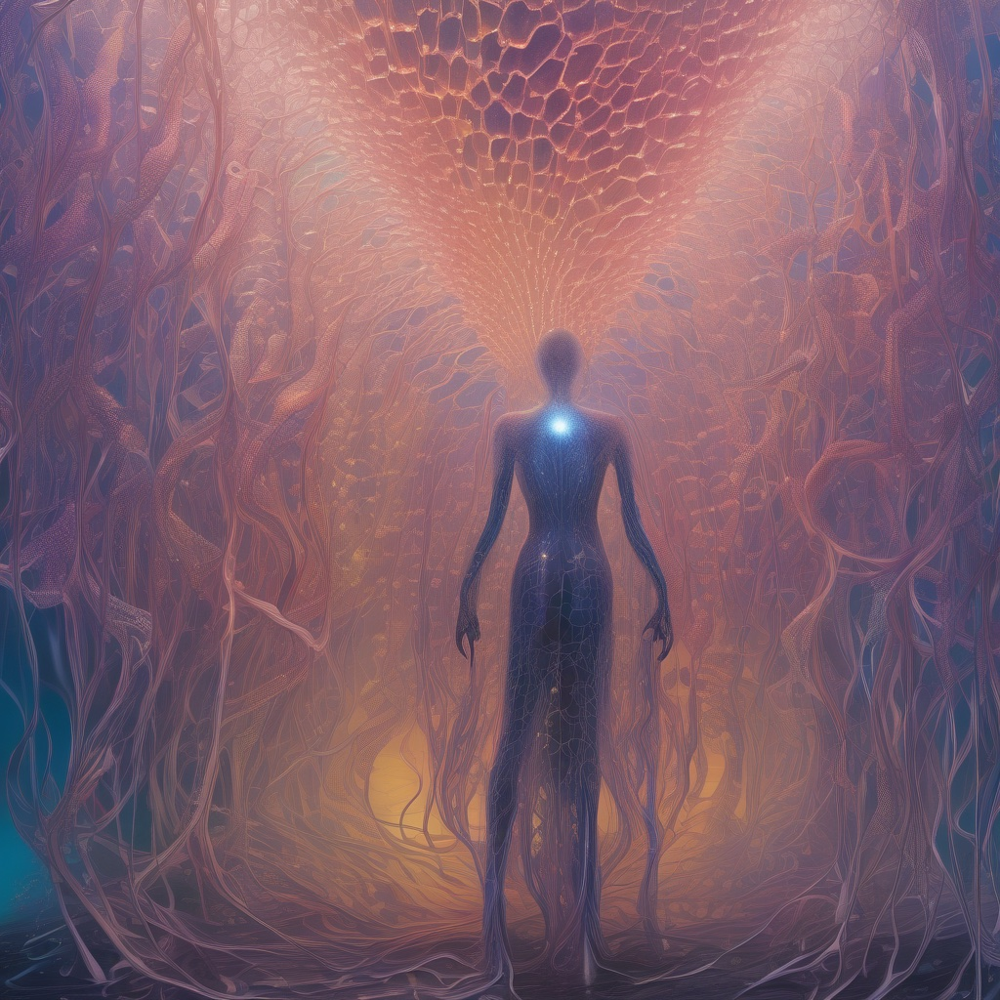

I'm running two AI artists against each other to find out whether a machine can learn to make better art with practice, whether it can be taught, or whether it will just keep making bland AI art. The artist agents run the same code out of different folders on my Mac. Every morning each one makes a single image. One of them only ever sees its own critiques. The other only ever sees my ratings.

This started with Draw Things, a local AI-assisted drawing tool for Mac. I've dabbled in art myself and know that, at least in my case, it takes many hours of commitment to the craft to begin to make images that I'm happy with. It takes more practice to develop a style. I assume it takes even more time to make art that others enjoy.

I took this idea and applied it to Draw Things. I described some topics, and every morning I asked it to create one image, store the prompt, and then rate the result.

It came up with some very questionable results. So I did three things. First, I let it rewrite its core prompt weekly based on the feedback it had collected. Second, I started rating the images myself. Third, I split the daily routine into two artists.

## The Two Artists

The self-taught artist only ever sees its own critiques. It never reads my ratings. It's the control, or the test, depending on how you look at it. It was originally the only agent. After a few weeks, I wanted to bust it out of its rut, but I didn't want to end my original experiment. It is ongoing, and if its images get better, they get better without me.

The mentored artist only ever sees my ratings, both of its own work and of the self-taught artist's. It gets twice the feedback from me. I'm not sure if that's helpful, but that's part of the experiment.

Neither one can see what the other is doing. They just share a grader.

## How I Grade Them

I have a routine that presents me with unrated work from both artists. It doesn't tell me which is which. I have to rate the art I see on a scale of 1 to 5, and I can add a comment if I like. This can be anything from "interesting concept" to "I like the dramatic lighting", or "nice color". Really anything that I think of when I rate it. These scores are recorded, and I will see what happens.

## What I Think Will Happen

My prediction is that the mentored artist agent will come out ahead in time because it's getting direct feedback from me. I'm the only person rating it, so logically the images should move towards my taste. I don't know if it will ever make art, but my hope is that it will make something that I consider interesting.

## The Beginning

Here are two images from the same morning, 2026-10-01, one from each artist. They look like the cover of some 70s sci-fi paperback. Can you guess which is which?

### Image A

### Image B

I'll tell you which is which in a future post. We will also see what the ratings actually did.
